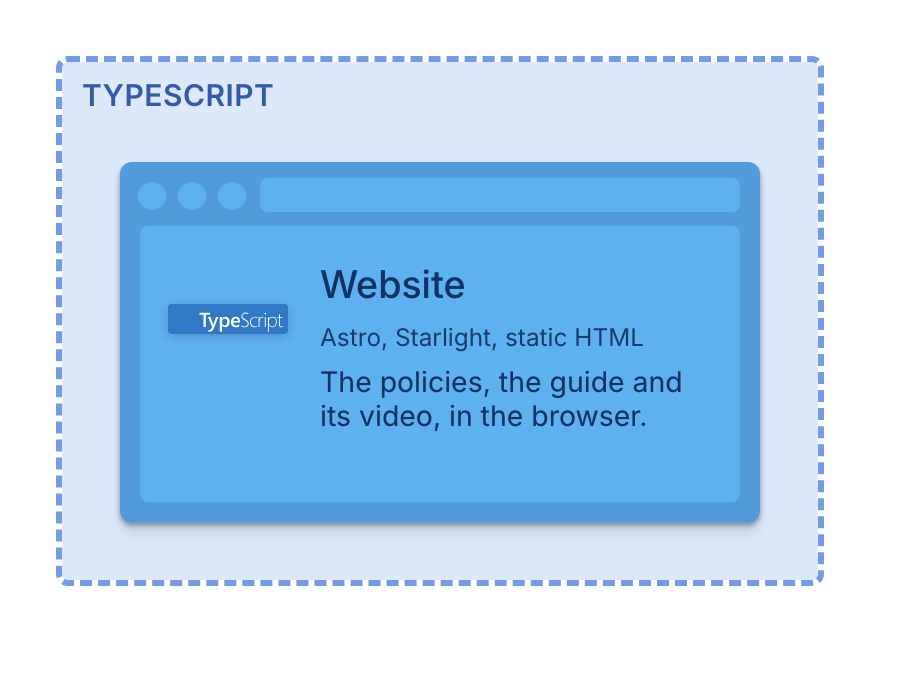
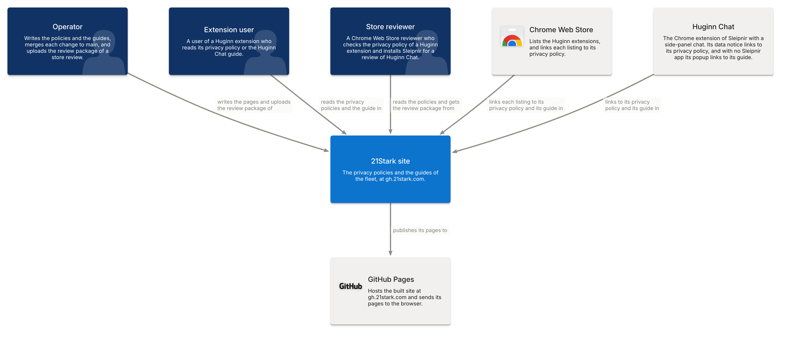
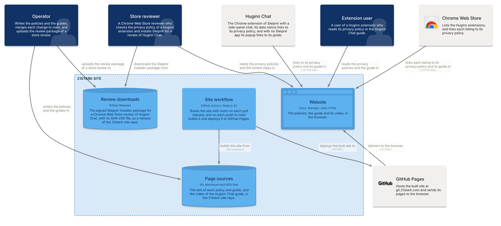

# Architecture: stark-site

The C4 model of stark-site, kept by [floorplan](https://github.com/21StarkCom/floorplan).

- `model/` holds the model. Edit these files.
- `kit/spec.c4` is a copy of the floorplan kit. `floorplan build` writes it again. Do not edit it.
- `proposals/` holds open proposals.
- `generated/` holds the outputs of `floorplan build`. Do not edit them.

Run `floorplan build` after each change to the model, and commit the outputs.
`floorplan check` fails when the outputs are older than the model.

## Views

<!-- floorplan:views:start -->
<!-- floorplan build writes this block. Do not edit it. -->

### Tech stack

### System Context: 21Stark site

### Containers: 21Stark site

<!-- floorplan:views:end -->
